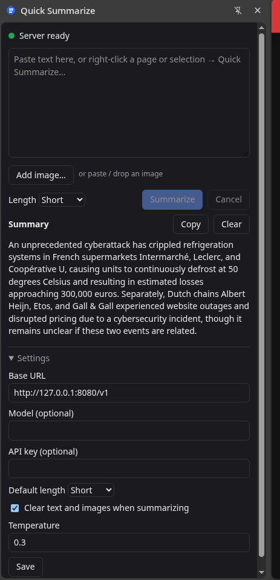
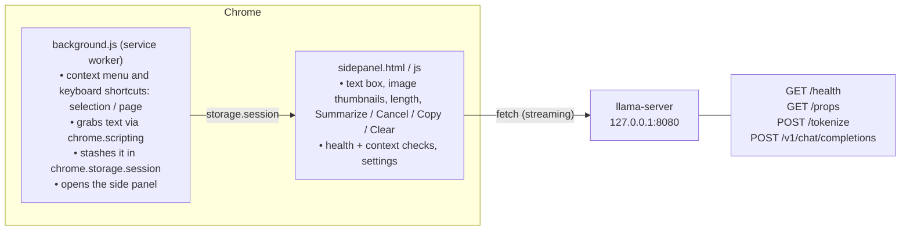
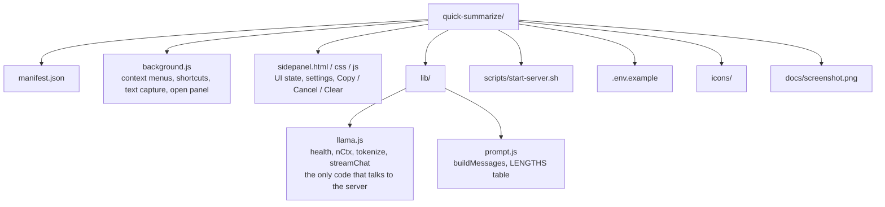
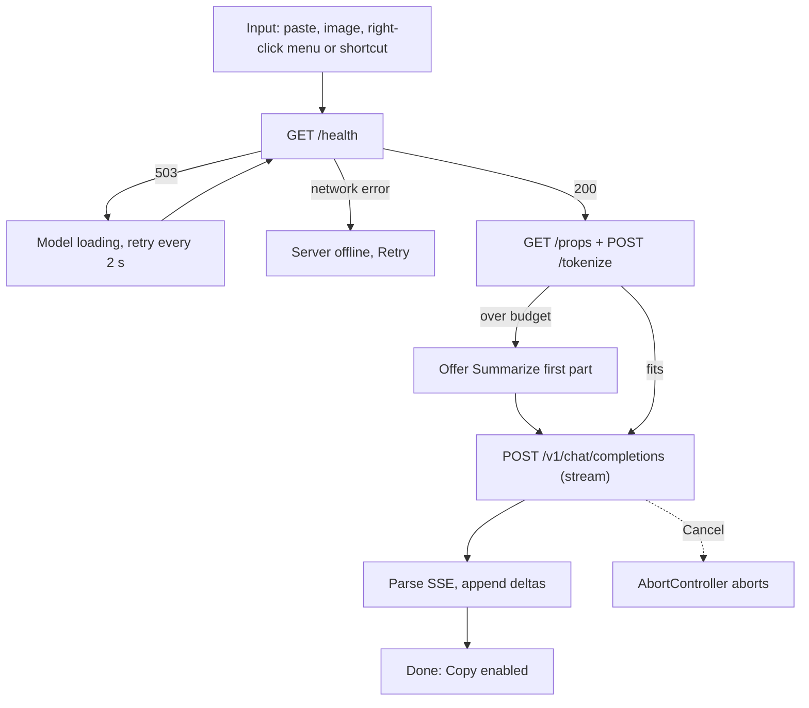

# Quick Summarize

A Chrome (Manifest V3) extension that summarizes text with a local Qwen model served by `llama-server`.
It summarizes pasted text, a selection, or the current page, and nothing leaves the machine.
There is no MCP server or client; the extension talks to `llama-server` over plain HTTP.

## Prerequisites

| Requirement | Notes |
| --- | --- |
| Chrome or Chromium 114+ | Needed for the Side Panel API (`chrome.sidePanel`). Other Chromium browsers work if they support it. |
| [llama.cpp](https://github.com/ggml-org/llama.cpp) | Built so that `build/bin/llama-server` exists. GPU offload (`-ngl 99`) needs a CUDA/ROCm/Metal/Vulkan build; drop the flag for CPU-only. |
| A Qwen GGUF model | A Qwen3.5-style model. Set `MODEL_PATH` in `.env`. |
| A matching `mmproj` GGUF | Passed as `--mmproj`; only needed for the planned image summaries, but the start script currently requires it. |
| Bash | Runs `scripts/start-server.sh` (Linux/macOS, or WSL on Windows). |
| Enough RAM/VRAM | The model plus the KV cache for `CTX_SIZE` (default 16384). |

## Packages

There are none to install. The extension is plain JavaScript (ES modules) with no `package.json`, no bundler,
no build step, and no runtime dependencies. Everything it uses is built into Chrome:

| API | Used for |
| --- | --- |
| `chrome.sidePanel` | The summary UI |
| `chrome.contextMenus` | *Summarize selection* / *Summarize page* |
| `chrome.scripting` + `activeTab` | Reading the selection or page text on a user action |
| `chrome.storage` (`local`, `session`) | Settings, and the last input and summary |
| `fetch` + `AbortController` | Streaming requests to `llama-server`, and Cancel |

The only external piece is `llama-server` from llama.cpp (see above).

## Setup

1. Clone this repo.
2. `cp .env.example .env` and fill in your paths (`.env` is gitignored):

   | Variable | Meaning | Default |
   | --- | --- | --- |
   | `LLAMA_CPP_DIR` | Your llama.cpp checkout | none |
   | `MODEL_PATH` | Model `.gguf` | none |
   | `MMPROJ_PATH` | Multimodal projector `.gguf` | none |
   | `HOST` / `PORT` | Where the server listens | `127.0.0.1` / `8080` |
   | `CTX_SIZE` | Context size passed as `--ctx-size` | `16384` |

3. Start the server: `./scripts/start-server.sh`
4. In `chrome://extensions`, enable Developer mode → **Load unpacked** → select this folder.
5. Click the toolbar icon to open the side panel, or right-click a page or selection →
   *Summarize page* / *Summarize selection*, or select text and press `Alt+Shift+S`
   (see [Keyboard shortcuts](#keyboard-shortcuts)).
6. Check the panel shows a green *Server ready* dot. If it can't connect, fix the base URL under **Settings**.

## The model server

The extension reuses the `llama-server` instance that `qwen-jev-controller` uses (default
`http://127.0.0.1:8080/v1`, same as `QWEN_BASE_URL`).

| Fact | Consequence for the extension |
| --- | --- |
| One model loaded; `model` is ignored | `model` is an optional setting, sent only if set |
| Qwen3.5 thinks by default | Sends `chat_template_kwargs: {enable_thinking: false}`; also strips any `<think>…</think>` |
| Context size depends on how the server was launched | Reads `n_ctx` from `GET /props` at runtime; never hardcoded |
| Optional `--api-key` | Optional API key setting, sent as `Authorization: Bearer …` |
| Shared with the Balatro bot | A summary may queue behind bot requests; the panel shows a waiting state and allows Cancel |

## Architecture

- **Side panel, not popup:** a popup closes (killing its request) when it loses focus, and local inference takes 10–60 s.
- **Request runs in the panel, not the service worker:** the panel stays alive for the whole request and renders the stream
  directly. Closing the panel cancels the request.
- **CORS:** extension pages with `host_permissions` for `http://127.0.0.1/*` are not subject to CORS, so no proxy is needed.

## Request flow

1. **Input.** Pasted text, images (paste, drop or file picker), the right-click menu, or a keyboard shortcut. *Selection* uses `window.getSelection().toString()` (keeps line
   breaks); *page* uses `document.body.innerText`. The service worker writes `{text, source, title, url}` to
   `chrome.storage.session` and opens the panel inside the menu-click or command handler (it needs a user gesture). The panel picks
   it up on load and on `storage.onChanged`.
2. **Server check** before each request: `GET /health` — `200` ready, `503` model loading, network error = not running.
3. **Context check.** `n_ctx` from `/props`, input size from `/tokenize`. Budget = `n_ctx − max_tokens − ~300 − image tokens`. Over
   budget shows "Text is ~N tokens; the server fits ~M" and offers **Summarize first part**.
4. **Request.** `POST /v1/chat/completions` with `stream: true` and an `AbortController` wired to Cancel.
5. **Stream.** Parse SSE `data:` lines, append deltas with `textContent`, stop at `[DONE]`. `finish_reason: length`
   shows a "cut off" note.
6. **Done.** Copy enabled; last input and summary kept in `chrome.storage.session`.

## Keyboard shortcuts

| Shortcut | Action |
| --- | --- |
| `Alt+Shift+S` | Summarize the selected text: opens the panel, fills in the selection, starts summarizing |
| `Alt+Shift+P` | Summarize the current page |
| `Alt+Shift+Q` | Open the panel |

Rebind them at `chrome://extensions/shortcuts`. Chrome skips a suggested key that is already in use.

## Prompt

Instructions go in the system message; the text goes in the user message inside `<text>` delimiters so the model treats
it as data (see `lib/prompt.js`).

| Length | Instruction | `max_tokens` |
| --- | --- | --- |
| Short | 1–2 sentences | 150 |
| Medium (default) | 3–5 bullet points | 400 |
| Long | One-sentence overview, then up to 10 bullets | 900 |

Temperature 0.3, `enable_thinking: false`. `model` is added only if set in settings.

## Images

Add up to 4 images by pasting (Ctrl+V with an image on the clipboard), dragging files onto the panel, or **Add image…**.
Images are downscaled to at most 1280 px on the long edge and re-encoded as JPEG in the panel, then sent as
`image_url` data-URL parts in the same chat request. Text and images can be combined; with no text the model
describes the images.

- Needs `llama-server` started with `--mmproj` (the start script does this). The panel checks `modalities.vision`
  from `GET /props` and shows an error if vision is not available.
- `/tokenize` does not count images, so the panel estimates each at `max(1024, ceil(w/28)·ceil(h/28))` tokens and
  subtracts that from the context budget.
- Images are kept only in `chrome.storage.session`, never written to disk.

## Settings

Stored in `chrome.storage.local`:

- **Saved immediately:** the Length dropdown next to Summarize, and "Clear text and images when summarizing" (clears the
  text box and images as soon as a request is sent; they come back if it fails or is cancelled with no output).
- **Saved with the Save button** (collapsible section): base URL, model (optional), API key (optional), temperature.

## UI states

| State | What the panel shows |
| --- | --- |
| Server offline | Red dot, "llama-server not reachable at …", start command, Retry |
| Model loading (`503`) | Amber dot, "Model loading…", auto-retry every 2 s |
| Ready | Green dot; Summarize enabled when the text is non-empty |
| Too long | Token count vs budget, "Summarize first part" |
| Waiting / streaming | Spinner until the first token, then live text; Cancel enabled |
| Error | The server's error message (first 300 chars), Retry |
| Done | Summary, Copy, "cut off" note if `finish_reason: length`; Clear resets the panel |

## Security notes

- Model output is rendered with `textContent` only, never `innerHTML`.
- Keep `llama-server` bound to `127.0.0.1`. It allows cross-origin requests by default, so any website you visit can
  call it from your browser. If that matters, start it with `--api-key` and put the key in the extension settings.
- Page text is read only on an explicit user action (menu click or keyboard shortcut). No content script runs on every page.
